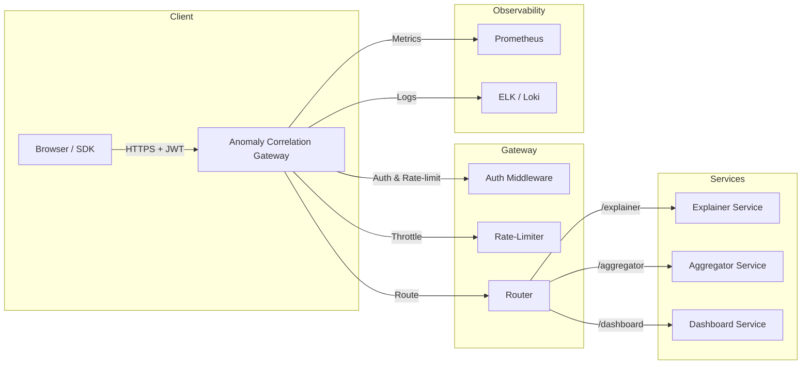

# Anomaly Correlation Gateway

**Category:** Full‑Stack  
**Stack:** Node.js / TypeScript  

Rate‑limited JWT API gateway that routes requests to the **explainer**, **aggregator**, and **dashboard** micro‑services. It centralises authentication, throttling, and request transformation, providing a single entry point for downstream analytics pipelines.

---

## Overview

The **Anomaly Correlation Gateway** (ACG) sits at the edge of your data‑science platform:

- **Authentication** – validates JWTs signed by your identity provider.
- **Rate limiting** – per‑user and per‑endpoint throttling using a token‑bucket algorithm.
- **Routing** – forwards validated requests to the appropriate micro‑service (explainer, aggregator, dashboard) while preserving request context.
- **Observability** – emits structured logs and Prometheus metrics for latency, error rates, and quota usage.

By offloading these cross‑cutting concerns to ACG, downstream services can stay focused on domain logic (e.g., anomaly detection, correlation, UI rendering) and scale independently.

---

## Theory / Architecture



### Key Components

| Component | Responsibility | Implementation Highlights |
|-----------|----------------|----------------------------|
| **Auth Middleware** | Verifies JWT signature, expiration, audience, and extracts `sub` (user ID) | Uses `jsonwebtoken` with TypeScript typings; configurable JWKS endpoint |
| **Rate‑Limiter** | Enforces per‑user, per‑endpoint quotas (e.g., 100 req/min) | Token‑bucket stored in Redis; fallback to in‑memory store for dev |
| **Router** | Maps `req.path` to target micro‑service; rewrites headers & body as needed | Express `router` + `http-proxy-middleware`; supports graceful fallback |
| **Metrics & Logging** | Emits request latency, status codes, throttling events | `prom-client` for Prometheus; `pino` for structured JSON logs |
| **Health & Config** | `/healthz` & `/readyz` endpoints; dynamic config reload via SIGHUP | Uses `node-config` with environment overrides |

### Data Flow

1. **Incoming request** arrives with `Authorization: Bearer <jwt>`.
2. **Auth Middleware** validates the token, populates `req.user`.
3. **Rate‑Limiter** checks the token bucket for `req.user.id` + endpoint; rejects with `429` if exhausted.
4. **Router** selects the downstream service based on the request path and forwards the request, preserving the original JWT for downstream auth (optional token propagation).
5. **Response** is streamed back to the client; metrics are recorded throughout the lifecycle.

---

## Quickstart

### Prerequisites

- Node.js **>= 18** (LTS)
- Yarn or npm
- Redis (for production‑grade rate limiting) – optional for local dev
- Access to your JWT issuer’s JWKS endpoint

### Installation

```bash
# Clone the repo
git clone https://github.com/yourorg/anomaly-correlation-gateway.git
cd anomaly-correlation-gateway

# Install dependencies
yarn install   # or npm ci

# Build TypeScript sources
yarn build     # or npm run build
```

### Configuration

Create a `.env` file (or use your preferred env manager) with the following minimal variables:

```dotenv
PORT=8080
JWT_ISSUER=https://auth.example.com/
JWT_AUDIENCE=acg-service
REDIS_URL=redis://localhost:6379   # optional, fallback to in‑memory
RATE_LIMIT_WINDOW_MS=60000        # 1 minute
RATE_LIMIT_MAX=120                # max requests per window per user
```

### Run locally

```bash
# Development mode (auto‑reload)
yarn dev   # or npm run dev

# Production mode
yarn start # or npm start
```

The gateway will be reachable at `http://localhost:8080`.

### Example: Calling the